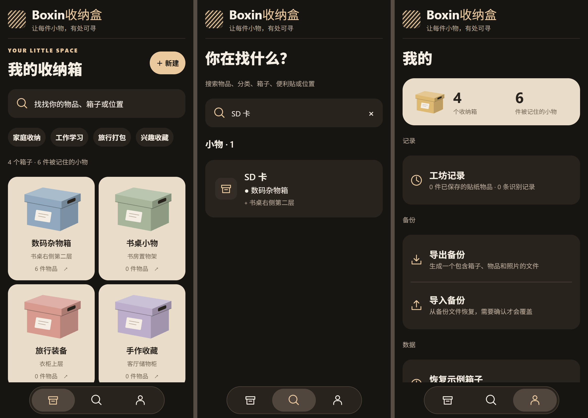

# Boxin收纳盒

[在线演示](https://kaitongzeng-web.github.io/boxin-storage/)

本地优先的个人收纳记忆 MVP。Expo / React Native / TypeScript 移动端，附浏览器演示与FastAPI 本地抠图服务。



## 启动

需要 Node.js 22.6+、npm；服务端需要 Python 3.11+。

```powershell
npm install
npm run web
```

浏览器访问终端输出的 localhost 地址。手机端运行 `npm start`，使用与 Expo SDK 54 兼容的 Expo Go 或开发构建扫码；Android 模拟器可用 `npm run android`。iOS 模拟器需要 macOS。

完整网页版：按下方「独立贴纸工坊」的命令安装依赖并下载模型，然后在项目根目录运行：

```powershell
npm run build:web
.\.venv\Scripts\python -m uvicorn boxie:app --app-dir server --host 127.0.0.1 --port 8018
```

打开 http://127.0.0.1:8018/ ，进入收纳箱 → 添加 → 拍照或从相册选择 → 生成贴纸 → 手动填写名称 → 保存物品。同一张照片有多件物品时，选择「识别整张照片中的物品」，逐件勾选、命名后确认入箱。物品相互接触或背景复杂时可能合并或漏检。单件模式可点选原图切换主体。名称和分类均由用户填写。仅录入文字时可以离线使用。

Expo 开发网页版也可在原有 localhost 地址使用此服务，保留原站点的本地数据。手机使用时将服务绑定到 `0.0.0.0`，在可信局域网内的「我的」填写电脑地址，例如 `http://192.168.1.20:8018`。

## 功能

- 收纳箱创建、编辑、七种颜色、便利贴、位置说明、确认删除。
- 拍照或相册选图，在本地服务生成带白边的透明 PNG；预览后与物品一同保存。
- 物品编辑、删除、跨箱移动；两侧更新时间同步。
- 名称、分类、箱子、备注和位置的中英文搜索；点击定位并高亮物品。
- 移动端以 SQLite 单行快照事务保存关联数据，照片存应用文档目录；Web 使用 localStorage。写入成功后才更新界面。
- 深色主题、奶油卡片、彩色纸盒、便利贴。纸盒的可见侧提手孔在独立箱盖侧板；另一相对侧被透视遮挡。
- 旧版识别记录和待确认草稿可继续查看与处理。
- 完整 JSON 备份包含照片、箱子、物品、识别记录；不带识别服务地址。网页下载文件，手机通过系统分享面板保存。导入先验证并预览数量，再合并为新记录，现有数据不覆盖，重复导入会产生副本。单文件限制 40MB。
- 删除箱子、物品或识别记录后，仅清理失去全部引用的应用内照片。确认历史也引用原图，可以在“我的”移除历史；不会删除相册原文件或其他应用文件。

## 验证

### 独立贴纸工坊

在项目根目录运行以下 PowerShell 命令，打开 http://127.0.0.1:8017/ 。工坊使用单独的服务入口。模型只需下载一次，之后可离线抠图。

```powershell
python -m venv .venv
.\.venv\Scripts\python -m pip install -r server/requirements-studio.txt
New-Item -ItemType Directory -Force .venv/models
Invoke-WebRequest https://github.com/danielgatis/rembg/releases/download/v0.0.0/u2netp.onnx -OutFile .venv/models/u2netp.onnx
.\.venv\Scripts\python -m uvicorn sticker_lab:lab --app-dir server --port 8017
```

上传或拖入照片后默认选择最大的前景区域，点原图可切换到其他已检出的独立区域。相互接触的物品可能合并。预览和导出使用同一张透明 PNG。独立工坊可另行配置命名服务；Boxin收纳盒主应用只使用抠图接口。

抠图通过 ONNX Runtime 在 CPU 上运行 [rembg 发布的 U²-Net 轻量权重](https://github.com/danielgatis/rembg/releases/tag/v0.0.0)。可用环境变量 `STICKER_MODEL` 指定该权重的位置。咖啡示例采用 [scikit-image 的 coffee 样张](https://scikit-image.org/docs/stable/api/skimage.data.html#skimage.data.coffee)，摄影者 Rachel Michetti，CC0。

### 项目检查

```powershell
npm test
npm run typecheck
npm run build:web
.\.venv\Scripts\python -m unittest discover -s server -p 'test_*.py'
git diff --check
```

数据层测试覆盖确认边界、重复提交、移动、删除、搜索、草稿恢复、照片引用、备份校验/合并和设置校验；服务测试覆盖健康检查、Mock、无效图片及缺少文件。

## 当前边界

当前为可演示 MVP：导航使用应用内状态，未接入深链；SQLite 保存聚合快照，后续可迁移规范化表。草稿编辑需要点击“保存草稿”或确认入箱；尚未保存的编辑不会恢复。没有可信边界框时使用分类符号和原图核对，不声称精确抠图。照片清理在成功保存删除操作后执行；应用在选图后异常终止可能留下未关联的文件，尚未提供全盘孤立文件扫描。清理失败会提示，不撤销已经保存的数据修改。

依赖审计仍有 Expo 工具链的 13 项告警（11 moderate、2 high）。尝试非强制修复后，原生打包检测发现其引入不匹配的嵌套 Expo 版本，因此已恢复原依赖锁定，仅新增备份所需的两个兼容模块。完整修复涉及 Expo 主版本升级；发布前需专项升级与真机回归。

浏览器演示受存储配额限制；照片较多请使用移动端。尚未完成 iOS/Android 真机权限和相机验收，也未在无密钥情况下验证真实视觉供应商。构建通过不等同于真机验收。
